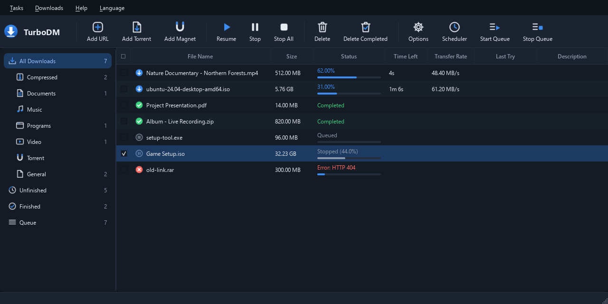
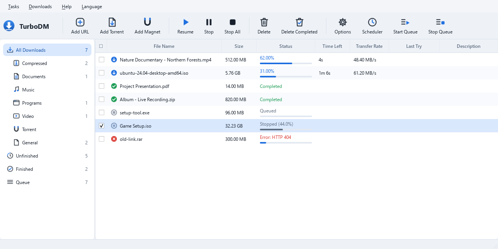

<p align="right"><a href="README.md">Türkçe</a> · <b>English</b></p>

<p align="center">
  
</p>

<h1 align="center">TurboDM</h1>
<p align="center"><b>A free IDM alternative</b><br>
Multi-connection downloads · Video grabber · Torrent · Browser integration</p>

<p align="center">
  <a href="https://github.com/wexaR-TDM/TurboDM/releases/latest"><b>⬇ Download the latest version</b></a>
  &nbsp;·&nbsp; Windows 10 / 11 (64-bit) &nbsp;·&nbsp; Free · no ads · non-profit personal project
</p>

> [!NOTE]
> **Frequent updates:** TurboDM is being updated often at the moment. During an update the program closes briefly; when installation finishes it reopens by itself in the taskbar and your active downloads continue where they left off. You don't need to do anything.

<p align="center">
  
</p>

---

## What can it do?

### 🚀 Fast downloads, the IDM way
- Splits the file into parts and downloads it **over several connections at once**; a connection that finishes helps out by splitting the largest remaining part in two (dynamic segmentation).
- **Resume:** even if the connection drops or the computer shuts down, the download continues from the same point.
- **Learns the server's connection limit:** if a server allows only a few connections (e.g. file hosting sites), surplus connections back off without breaking the download; while things run smoothly a new connection is tried now and then, and speed increases if the server allows it.
- Refreshes expired download addresses automatically where possible. HTTP, HTTPS and FTP.
- An IDM-style download window: segmented progress bar of the connections, **speed limiter**, **"when done: shut down / sleep / exit"**.

### 🎬 Video downloads
- The browser extension places a **"Download this video"** button over the video on the page; clicking it lists the qualities (4K, 1080p, audio only…) and the chosen quality comes ready in TurboDM's save window.
- Hundreds of video sites are supported (via yt-dlp). HLS (m3u8), DASH (mpd) and encrypted (AES-128) streams are downloaded and merged into a single file.
- Embedded players (video served from another site) are supported: the video is requested with the player's own address.
- **Format choice:** when the download finishes it is kept as MP4 or saved as **MKV** (lossless, takes seconds), **AVI** (for older TVs/players) or **MP3** (audio only).
- DRM-protected streams (Netflix, Disney+ etc.) are not downloaded.

### 🧲 Torrent
- Magnet links and .torrent files open directly in TurboDM; choose files before downloading.
- Upload speed is adjusted automatically while downloading (a saturated upload line slows downloads), encrypted connections and a random port.

### 🧩 Browser integration (Edge / Chrome)
- Downloads started in the browser go to TurboDM automatically; right-click → **"Download with TurboDM"**.
- Lists the video/audio streams loaded by the page in the extension window. The extension contains no site-specific code and works the same on every site.

### 🗂 Organization and interface
- Categories, queue, scheduler; **bulk selection and bulk actions** with checkboxes.
- A TurboDM theme that **follows Windows light/dark mode automatically**.
- One-click update from inside the program (*Help → Check for updates*); active downloads continue where they left off.
- **7 languages:** English, Türkçe, Deutsch, Français, Español, العربية, Italiano — switch instantly from the **Language** menu in the menu bar (the program stays open); by default the Windows language is used, and the language can also be chosen during setup.

<p align="center">
  
</p>

---

## Installation
1. Download **TurboDM-Setup-x.x.x.exe** from the [releases page](https://github.com/wexaR-TDM/TurboDM/releases/latest). (You don't need the "Source code" files; GitHub adds them to every release itself.)
2. Run the setup and choose your language. Everything needed (ffmpeg, yt-dlp etc.) is included.
3. Browser extension: Start menu → **TurboDM → "Browser extension (setup help)"**. The extension is under review in the Microsoft Edge Add-ons store; once approved, setup will offer it automatically.

## 🔒 Security and privacy
- **No data collection:** no ads, usage statistics or tracking. The program connects only to the sites you download from, and to GitHub to check for updates.
- **The extension sends nothing out:** download addresses and the necessary cookies are passed only to TurboDM on your own computer (127.0.0.1). → [Privacy policy](PRIVACY.md)
- **Protected local bridge:** websites cannot send requests to TurboDM's local address (mandatory custom header, DNS rebinding protection).
- **Updates are digitally signed:** the update information of every release is signed (Ed25519) with a key that exists only on the developer's computer; TurboDM does not install an update whose signature cannot be verified. So even if this GitHub account were taken over, no fake "update" could be distributed to users. The setup file is also downloaded only from the official release on this page and its SHA-256 digest is checked.
- **Build integrity:** the helper programs bundled with setup (ffmpeg, yt-dlp, deno) are taken from their official sources after verification; every build compares them with their verified digests and stops if anything changed.
- **Administrator rights only during setup**; the program runs as a normal user. The uninstaller cleans up without traces according to the options you choose and never touches your downloaded files unless you ask.

> ⚠ **"Windows protected your PC" warning:** the setup file is not code-signed yet; Windows SmartScreen may show a warning → *More info → Run anyway*. Some antivirus programs may raise false alarms on new unsigned programs. Download the file only from this page; if you like, upload it to [VirusTotal](https://www.virustotal.com) or verify its SHA-256 digest (shown in the file details on the release page and in `latest.json`):
> ```powershell
> Get-FileHash .\TurboDM-Setup-x.x.x.exe -Algorithm SHA256
> ```

Open source components used: yt-dlp, ffmpeg (LGPL), libtorrent, deno — their license texts ship with the installer.
Download copyrighted content only to the extent permitted by the rights holder.

## 📝 Release notes
See what changed in every version in **[RELEASE_NOTES.md](RELEASE_NOTES.md)** (in the program: *Help → Release notes*). Türkçe: [SURUM_NOTLARI.md](SURUM_NOTLARI.md)

## 🛣 Roadmap
- [x] Multi-connection downloads, resume, speed limit, queue and scheduler
- [x] Video grabber with in-page quality menu, HLS
- [x] Torrent (magnet, file selection, automatic upload limit)
- [x] Automatic update from inside the program (GitHub)
- [x] TurboDM theme that follows light/dark mode, bulk actions
- [x] Smart connection management that learns the server's connection limit
- [x] DASH streams, embedded player support, MKV/AVI/MP3 conversion
- [x] Open source (GPL v3)
- [x] 7 languages (program, setup and browser extension)
- [ ] Publishing the browser extension in the Edge Add-ons store (under review), then the Chrome Web Store
- [ ] Code-signed setup file (no more SmartScreen warning)

## 🛠 Building from source
TurboDM's source code is in this repository; anyone can review it and build it themselves.
- **Requirements:** Windows 10/11, Python 3.12, `pip install -r requirements.txt` and PyInstaller, Inno Setup 6.
- **Helper programs:** `installer\fetch_tools.ps1` downloads yt-dlp and deno from their official releases with SHA-256 verification. For ffmpeg (LGPL, BtbN) see `vendor\ffmpeg\source\DERLEME_BILGISI.txt`. Then run `installer\pin_vendor.ps1`.
- **Run:** `python main.py`  ·  **Tests:** `tests\run_tests.ps1`  ·  **Setup file:** `build.ps1 -NoInstall`
- **Translations:** the program's texts are in `turbodm/locale/<language>.json` (Turkish text → translation). Corrections are welcome.
- The update information of official releases is signed with the developer's private key. A copy you build yourself does not have this key and therefore cannot publish releases to the official update channel; this is a deliberate security measure.

Development notes (Turkish): [docs/GELISTIRME.md](docs/GELISTIRME.md)

## 📄 License
TurboDM is licensed under the **GNU General Public License v3 (GPL-3.0)**: you may use, study, modify and share it; modified versions must also be shared under the same license together with their source code. Details: [LICENSE](LICENSE). Licenses of the open source components used: [installer/LISANSLAR.txt](installer/LISANSLAR.txt).

## ⚖ Reporting infringement
TurboDM is a free, non-profit personal project and does not host or distribute any content; it only downloads files the user chooses. If you believe any part of the program, its descriptions or any content on this page infringes your rights, please report it by **[opening an issue](https://github.com/wexaR-TDM/TurboDM/issues/new?title=Infringement%20report)**: the relevant part will be reviewed and, if necessary, removed or corrected without delay.

TurboDM is not intended for downloading copyrighted content without permission; users are responsible for the content they download.

## Feedback
For bugs or suggestions, open an issue on the [Issues](https://github.com/wexaR-TDM/TurboDM/issues) page. When reporting a bug, it helps a lot to include your Windows version and how the problem occurred.
