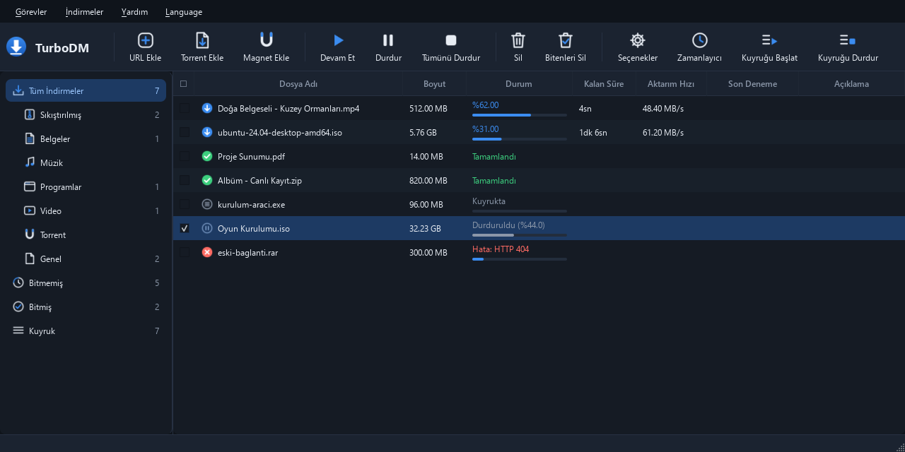
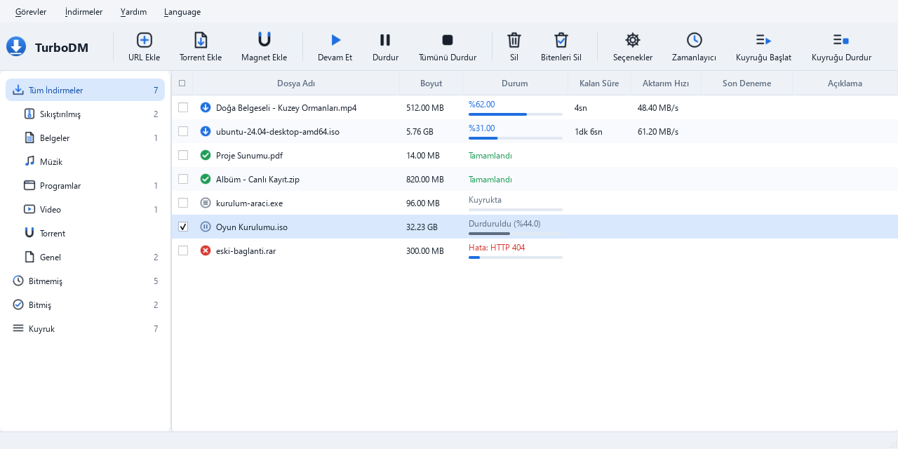

<p align="center">
  
</p>

<h1 align="center">TurboDM</h1>
<p align="center"><b>Türkçe, ücretsiz bir IDM alternatifi</b><br>
Çok bağlantılı indirme · Video yakalayıcı · Torrent · Tarayıcı entegrasyonu</p>

<p align="center">
  <a href="https://github.com/wexaR-TDM/TurboDM/releases/latest"><b>⬇ Son sürümü indir</b></a>
  &nbsp;·&nbsp; Windows 10 / 11 (64 bit) &nbsp;·&nbsp; Ücretsiz · reklamsız · kâr amacı gütmeyen kişisel proje
</p>

<p align="center">
  
</p>

---

## Neler yapabiliyor?

### 🚀 IDM mantığıyla hızlı indirme
- Dosyayı parçalara bölüp **aynı anda birden çok bağlantıyla** indirir; biten bağlantı kalan en büyük parçayı ikiye bölerek yardıma koşar (dinamik bölümleme).
- **Kaldığı yerden devam:** bağlantı kopsa, bilgisayar kapansa da indirme aynı yerden sürer.
- **Sunucu bağlantı sınırını öğrenir:** sunucu az bağlantıya izin veriyorsa (ör. dosya paylaşım siteleri) fazla bağlantılar indirmeyi bozmadan çekilir; indirme sorunsuz giderken arada yeni bağlantı denenir, sunucu izin verirse hız artar.
- Süresi dolan indirme adreslerini mümkünse kendiliğinden yeniler. HTTP, HTTPS ve FTP desteği.
- IDM'deki gibi indirme penceresi: bağlantıların parçalı ilerleme çubuğu, **hız sınırlayıcı**, **"bitince bilgisayarı kapat / uyut / programdan çık"**.

### 🎬 Video indirme
- Tarayıcı eklentisi, sayfadaki videonun üstüne **"Bu videoyu indir"** düğmesi koyar; tıklayınca kaliteler listelenir (4K, 1080p, yalnızca ses…), seçilen kalite TurboDM'in kayıt penceresinde hazır gelir.
- Yüzlerce video sitesi desteklenir (yt-dlp ile). HLS (m3u8), DASH (mpd) ve şifreli (AES-128) akışlar indirilip tek dosyada birleştirilir.
- Gömülü oynatıcılar (başka siteden gelen video) desteklenir: video, oynatıcının kendi adresiyle istenir.
- **Biçim seçimi:** indirme bitince MP4 olarak bırakılır ya da **MKV** (kayıpsız, saniyeler sürer), **AVI** (eski TV/oynatıcılar için) veya **MP3** (yalnızca ses) olarak kaydedilir.
- DRM ile korunan yayınlar (Netflix, Disney+ vb.) indirilmez.

### 🧲 Torrent
- Magnet bağlantıları ve .torrent dosyaları doğrudan TurboDM'de açılır; indirmeden önce dosya seçimi.
- İndirirken yükleme hızı otomatik ayarlanır (dolan yükleme hattı indirmeyi yavaşlatır), şifreli bağlantı ve rastgele port.

### 🧩 Tarayıcı entegrasyonu (Edge / Chrome)
- Tarayıcıda başlatılan indirmeler otomatik olarak TurboDM'e gider; sağ tık → **"TurboDM ile indir"**.
- Sayfanın yüklediği video/ses akışlarını eklenti penceresinde listeler. Eklenti siteye özel kod içermez, her sitede aynı çalışır.

### 🗂 Düzen ve arayüz
- Kategoriler, kuyruk, zamanlayıcı; onay kutularıyla **toplu seçim ve toplu işlem**.
- **Windows'un açık/koyu moduna kendiliğinden uyan** TurboDM teması.
- Program içinden tek tıkla güncelleme (*Yardım → Güncellemeleri denetle*); güncellemede inmekte olan indirmeler kaldığı yerden sürer.
- Tamamen Türkçe.

<p align="center">
  
</p>

---

## Kurulum
1. [Sürümler sayfasından](https://github.com/wexaR-TDM/TurboDM/releases/latest) **TurboDM-Setup-x.x.x.exe** dosyasını indirin. ("Source code" dosyalarına gerek yok; GitHub onları her sürüme kendisi ekler.)
2. Kurulumu çalıştırın. ffmpeg, yt-dlp vb. gerekli her şey içinde gelir.
3. Tarayıcı eklentisi: Başlat menüsü → **TurboDM → "Tarayıcı Eklentisi (kurulum yardımı)"**. Eklenti Microsoft Edge Eklentiler mağazasında incelemede; onaylanınca kurulumda otomatik önerilecek.

## 🔒 Güvenlik ve gizlilik
- **Veri toplamaz:** reklam, kullanım istatistiği ya da izleme yok. Program yalnızca indirmek istediğiniz sitelere ve güncelleme denetimi için GitHub'a bağlanır.
- **Eklenti veriyi dışarı göndermez:** indirme adresleri ve gerekli çerezler yalnızca kendi bilgisayarınızdaki TurboDM'e (127.0.0.1) iletilir. → [Gizlilik politikası](PRIVACY.md)
- **Yerel köprü korumalı:** web siteleri TurboDM'in yerel adresine istek gönderemez (özel başlık zorunluluğu, DNS rebinding koruması).
- **Güncellemeler dijital imzalıdır:** her sürümün güncelleme bilgisi, yalnızca geliştiricinin bilgisayarında bulunan bir anahtarla (Ed25519) imzalanır; TurboDM imzası doğrulanmayan güncellemeyi kurmaz. Böylece bu GitHub hesabı ele geçirilse bile kullanıcılara sahte bir "güncelleme" dağıtılamaz. Ayrıca kurulum dosyası yalnızca bu sayfadaki resmi sürümden indirilir ve SHA-256 özeti kontrol edilir.
- **Derleme bütünlüğü:** kuruluma giren yardımcı programlar (ffmpeg, yt-dlp, deno) resmi kaynaklarından doğrulanarak alınır; her derlemede doğrulanmış özetleriyle karşılaştırılır, değişmişse derleme durur.
- **Yönetici izni yalnızca kurulumda**; program normal kullanıcı olarak çalışır. Kaldırıcı seçtiğiniz seçeneklere göre iz bırakmadan temizler, indirdiğiniz dosyalara siz istemedikçe dokunmaz.

> ⚠ **"Bilgisayarınız korundu" uyarısı:** Kurulum dosyası henüz dijital olarak imzalı değil; Windows SmartScreen uyarı gösterebilir → *Ek bilgi → Yine de çalıştır*. Bazı antivirüsler imzasız yeni programlarda yanlış alarm verebilir. Dosyayı yalnızca bu sayfadan indirin; isterseniz [VirusTotal](https://www.virustotal.com)'a yükleyin ya da SHA-256 özetini doğrulayın (sürüm sayfasındaki dosya bilgisinde ve `latest.json` içinde yazar):
> ```powershell
> Get-FileHash .\TurboDM-Setup-x.x.x.exe -Algorithm SHA256
> ```

Kullanılan açık kaynak bileşenler: yt-dlp, ffmpeg (LGPL), libtorrent, deno — lisans metinleri kurulumla birlikte gelir.
Telif hakkıyla korunan içerikleri yalnızca hak sahibinin izin verdiği ölçüde indirin.

## 📝 Sürüm notları
Her sürümde nelerin değiştiğini **[SURUM_NOTLARI.md](SURUM_NOTLARI.md)** dosyasında görebilirsiniz (programda: *Yardım → Sürüm notları*).

## 🛣 Yol haritası
- [x] Çok bağlantılı indirme, devam, hız sınırı, kuyruk ve zamanlayıcı
- [x] Video yakalayıcı ve sayfa içi kalite menüsü, HLS
- [x] Torrent (magnet, dosya seçimi, otomatik yükleme sınırı)
- [x] Program içinden otomatik güncelleme (GitHub)
- [x] Açık/koyu moda uyan TurboDM teması, toplu işlem
- [x] Sunucu bağlantı sınırını öğrenen akıllı bağlantı yönetimi
- [x] DASH akışları, gömülü oynatıcı desteği, MKV/AVI/MP3 dönüştürme
- [x] Açık kaynak (GPL v3)
- [ ] Tarayıcı eklentisinin Edge Eklentiler mağazasında yayımlanması (incelemede), ardından Chrome Web Mağazası
- [ ] İmzalı kurulum dosyası (SmartScreen uyarısının kalkması)

## 🛠 Kaynaktan derleme
TurboDM'in kaynak kodu bu depodadır; isteyen inceleyebilir ve kendisi derleyebilir.
- **Gerekenler:** Windows 10/11, Python 3.12, `pip install -r requirements.txt` ve PyInstaller, Inno Setup 6.
- **Yardımcı programlar:** `installer\fetch_tools.ps1` yt-dlp ve deno'yu resmi sürümlerinden SHA-256 doğrulamasıyla indirir. ffmpeg (LGPL, BtbN) için bkz. `vendor\ffmpeg\source\DERLEME_BILGISI.txt`. Ardından `installer\pin_vendor.ps1` çalıştırılır.
- **Çalıştırma:** `python main.py`  ·  **Testler:** `tests\run_tests.ps1`  ·  **Kurulum dosyası:** `build.ps1 -NoInstall`
un_tests.ps1`  ·  **Kurulum dosyası:** `build.ps1 -NoInstall`
- Resmi sürümlerin güncelleme bilgisi geliştiricinin özel anahtarıyla imzalanır. Kendi derlediğiniz kopya bu anahtara sahip olmadığı için resmi güncelleme kanalına sürüm yayımlayamaz; bu bilinçli bir güvenlik önlemidir.

Geliştirme notları: [docs/GELISTIRME.md](docs/GELISTIRME.md)

## 📄 Lisans
TurboDM, **GNU Genel Kamu Lisansı v3 (GPL-3.0)** ile lisanslanmıştır: kullanabilir, inceleyebilir, değiştirebilir ve paylaşabilirsiniz; değiştirilmiş sürümler de aynı lisansla ve kaynak koduyla birlikte paylaşılmalıdır. Ayrıntılar: [LICENSE](LICENSE). Kullanılan açık kaynak bileşenlerin lisansları: [installer/LISANSLAR.txt](installer/LISANSLAR.txt).

## ⚖ Hak ihlali bildirimi
TurboDM kâr amacı gütmeyen, ücretsiz bir kişisel projedir ve hiçbir içerik barındırmaz ya da dağıtmaz; yalnızca kullanıcının kendi seçtiği dosyaları indirir. Programın herhangi bir parçasının, açıklamalarının ya da bu sayfadaki bir içeriğin haklarınızı ihlal ettiğini düşünüyorsanız lütfen **[bir kayıt (issue) açarak](https://github.com/wexaR-TDM/TurboDM/issues/new?title=Hak%20ihlali%20bildirimi)** bildirin: ilgili kısım incelenir ve gerekirse gecikmeden kaldırılır ya da düzeltilir.

TurboDM'in telif hakkıyla korunan içeriklerin izinsiz indirilmesi için kullanılması amaçlanmamıştır; kullanıcılar indirdikleri içerikten kendileri sorumludur.

## Geri bildirim
Hata ya da öneri için [Issues](https://github.com/wexaR-TDM/TurboDM/issues) sayfasından kayıt açabilirsiniz. Hata bildirirken Windows sürümünüzü ve sorunun nasıl oluştuğunu yazmanız çok yardımcı olur.
